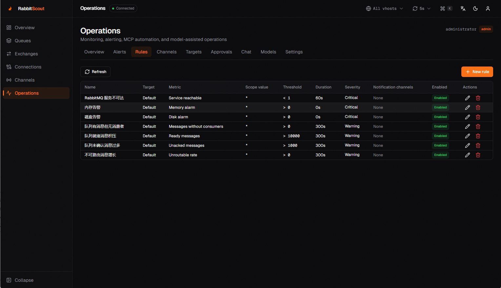
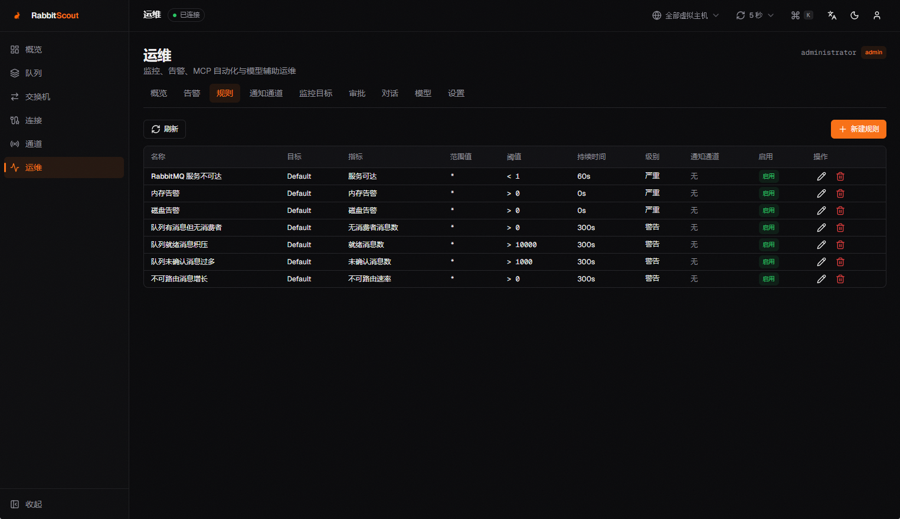
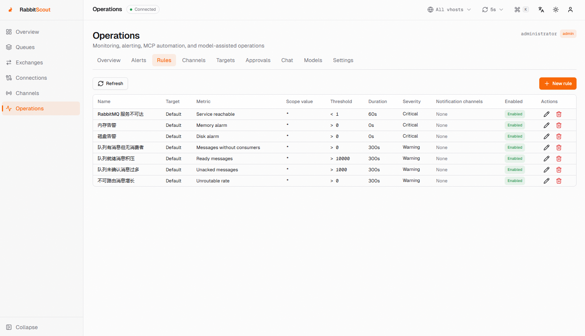
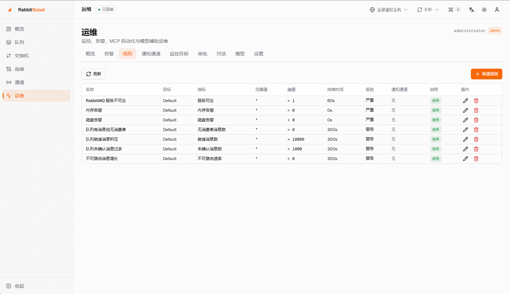

# 海心云 MQ 管理台

[English](README.md) | 简体中文 | [项目主页](https://cn-cam.github.io/hainmq-console/)

一个现代化、开源的 RabbitMQ 管理与运维控制台。

> HainMQ Console · 基于 RabbitScout（MIT）

海心云 MQ 管理台是 RabbitScout 的分支，新增了中英双语界面、可配置品牌、运维模块、MCP 自动化和模型辅助对话。

RabbitMQ 是其各自权利人的商标。本项目与 RabbitMQ 项目及其商标权利人无隶属、赞助或背书关系。


---

## 功能

**仪表盘** — 实时概览，包含基于 Canvas 的流式图表、可调时间范围（实时 / 10 分钟 / 1 小时 / 8 小时 / 24 小时，使用 Broker 自身保留的采样数据）、队列分布、带内存/磁盘告警的集群健康状态，以及动态统计。

**队列** — 创建（classic、quorum、stream）、查看和删除队列。详情抽屉展示每个队列的速率历史、消费者和参数。支持分页和排序查看消息、发布带自定义消息头的测试消息、确认后清空队列，以及输入队列名确认删除。

**交换机** — 声明和删除交换机、查看绑定，并向队列添加新绑定。

**连接** — 监控活动连接，展示客户端提供的连接名、吞吐量指标和详情抽屉；需要时可关闭连接。

**通道** — 查看通道状态、预取数量、速率和消费者数量。

**多语言** — 支持英文和简体中文界面。默认英文，可在登录页或仪表盘右上角切换语言，选择结果保存在 cookie 中。

**运维模块** — 内置 Broker 健康、队列、消息、连接和通道监控。支持告警规则、多个邮件/Webhook 通道、MCP（本地 opencode）、写操作审批和模型辅助对话。使用嵌入式 SQLite 和进程内调度，不引入 PostgreSQL 或独立 Worker。详见 [运维模块配置指南](docs/ops-module.zh-CN.md)。

**命令面板** — 使用 `Ctrl/⌘ K` 跳转到任意页面或队列、切换主题或暂停实时更新。

**实时数据控制** — 顶栏显示 Broker 连接状态，支持刷新频率选择（2 秒 → 30 秒或暂停）、标签页隐藏时自动暂停，以及全局 vhost 范围切换。

**认证** — 透传认证。每个用户使用自己的 RabbitMQ 凭据登录，服务端不保存密码。兼容 RabbitMQ 3.x 和 4.x。

**主题** — 深色和浅色模式，界面简洁，完整响应式，支持移动端。

---

## 快速开始

### 前置条件

- Node.js 20.9+（推荐 Node 24 LTS）
- 一个已启用 [Management 插件](https://www.rabbitmq.com/docs/management) 的 RabbitMQ 实例

### 安装

```bash
git clone https://github.com/cn-cam/hainmq-console.git
cd hainmq-console
npm install
```

### 配置

从示例文件创建 `.env`：

```bash
cp .env.example .env
```

编辑 `.env`，填入 RabbitMQ Management API 地址：

```env
RABBITMQ_HOST=localhost
RABBITMQ_PORT=15672
RABBITMQ_PROTOCOL=http
```

无需在配置中填写用户名和密码——用户在登录页使用自己的 RabbitMQ 凭据认证。

### 运行

```bash
# 开发模式
npm run dev

# 生产模式
npm run build && npm start
```

打开 [http://localhost:3000](http://localhost:3000)，使用 RabbitMQ 凭据登录。

### 无 Broker 开发

仓库内置了一个模拟 RabbitMQ Management API 的服务（兼容 3.x 和 4.x 响应结构）：

```bash
npm run mock          # 在 :15672 启动模拟 Broker（用户：admin/admin、monitor/monitor、plain/plain）
npm run dev           # 将 RABBITMQ_PORT=15672 指向它
```

### 运维模块

运维模块是可选的，复用当前登录。启用步骤：

```bash
cp .env.ops.example .env
# 设置 OPS_ENCRYPTION_KEY、OPS_MCP_TOKEN、OPS_RABBITMQ_USERNAME、OPS_RABBITMQ_PASSWORD
docker compose up -d --build
```

使用具有 `administrator`、`policymaker`、`management` 或 `monitoring` tag 的 RabbitMQ 用户访问 `/ops`。完整配置、MCP/opencode 接入、告警规则、Webhook 签名和故障排查见 [docs/ops-module.zh-CN.md](docs/ops-module.zh-CN.md)。

---

## Docker

### 预构建镜像（Docker Hub）

支持 `linux/amd64` 和 `linux/arm64` 多架构：

```bash
docker pull cocam/hainmq-console:2.1.2

docker run -d --name hainmq-console \
  -p 3000:3000 \
  -e RABBITMQ_HOST=host.docker.internal \
  -e RABBITMQ_PORT=15672 \
  -e RABBITMQ_PROTOCOL=http \
  -v hainmq-data:/app/data \
  --restart=always \
  cocam/hainmq-console:2.1.2
```

可用标签：`2.1.2`、`2.1`、`2`、`latest`。

### Docker Compose（推荐）

```bash
cp .env.example .env
# 编辑 .env：RABBITMQ_HOST、HAINMQ_IMAGE、HAINMQ_PORT 等
docker compose up -d --build
```

Compose 默认将 `RABBITMQ_HOST` 设为 `host.docker.internal`，可直接连接 Docker Desktop 上的 RabbitMQ 容器或本机 Broker。在 Linux 上，Compose 文件已包含 `host-gateway` 配置，效果相同。

### docker run

本地构建镜像（上游 GHCR 镜像不包含本分支的改动）：

```bash
docker build -t hainmq-console:2.1.2 .

docker run -d --name hainmq-console \
  -p 3000:3000 \
  -e RABBITMQ_HOST=host.docker.internal \
  -e RABBITMQ_PORT=15672 \
  -e RABBITMQ_PROTOCOL=http \
  -v hainmq-data:/app/data \
  --restart=always \
  hainmq-console:2.1.2
```

如果本仓库启用了 GitHub Actions，`docker-publish.yml` 会构建并推送多架构镜像到 GHCR 和 Docker Hub。否则请本地构建或使用 Compose。

镜像以非 root 用户运行，并内置针对 `/api/health` 的容器 `HEALTHCHECK`。

---

## 环境变量

| 变量 | 必填 | 默认值 | 说明 |
|---|---|---|---|
| `RABBITMQ_HOST` | 是 | `localhost` | RabbitMQ Management API 主机名 |
| `RABBITMQ_PORT` | 否 | `15672` | Management API 端口（标准端口可省略） |
| `RABBITMQ_PROTOCOL` | 否 | `http` | `http` 或 `https` |
| `RABBITMQ_API_TIMEOUT_MS` | 否 | `15000` | API 请求超时时间（毫秒） |
| `COOKIE_SECURE` | 否 | 自动 | 强制设置会话 cookie 的 `Secure` 属性（`true`/`false`）。默认按请求自动检测，包括代理后的 `x-forwarded-proto` |

### 运维模块变量

| 变量 | 默认值 | 说明 |
|---|---|---|
| `OPS_RABBITMQ_USERNAME` | — | 后台采集使用的只读 RabbitMQ 账号 |
| `OPS_RABBITMQ_PASSWORD` | — | 采集账号密码 |
| `OPS_ENCRYPTION_KEY` | — | 用于加密存储密钥的 base64 32 字节密钥 |
| `OPS_MCP_TOKEN` | — | MCP Server 的 Bearer Token |
| `OPS_MCP_ALLOW_WRITE` | `true` | 是否注册写工具；写操作仍需人工审批 |
| `OPS_MCP_ALLOW_PEEK` | `false` | 是否允许 MCP/对话查看消息体；敏感环境建议关闭 |
| `OPS_MCP_ALLOWED_VHOSTS` | `/` | Vhost 白名单，逗号分隔；`*` 表示全部 |
| `OPS_MCP_QUEUE_PREFIXES` | — | 可选的队列前缀白名单，逗号分隔 |
| `OPS_POLL_INTERVAL_MS` | `60000` | 采集间隔（毫秒） |
| `OPS_ADMIN_USERS` | `administrator` | 允许管理运维模块的 RabbitMQ 用户名，逗号分隔；留空表示所有管理员 |
| `OPS_WEBHOOK_ALLOW_PRIVATE` | `false` | 是否允许 Webhook 访问内网地址 |
| `OPS_CHAT_ENABLED` | `true` | 是否启用运维对话；也可在设置页切换 |
| `OPS_DB_PATH` | `/app/data/ops.db` | 嵌入式 SQLite 数据库路径 |

完整模板见 [.env.ops.example](.env.ops.example)。

### 品牌与版权

这些是公开的运行时变量，修改后重启容器即可，无需重新构建。

| 变量 | 默认值 | 说明 |
|---|---|---|
| `APP_NAME` | `海心云` | 登录页和侧边栏显示的产品名称 |
| `APP_PRODUCT_NAME` | `MQ 管理台` | 产品副标题 |
| `APP_COPYRIGHT` | `© 2026 海心云` | 登录页和仪表盘页脚显示的版权信息 |
| `APP_LICENSE` | `MIT` | 页脚显示的开源协议 |
| `APP_LICENSE_URL` | 本仓库 `LICENSE` | 协议链接 |
| `APP_ATTRIBUTION` | `Based on RabbitScout (MIT)` | 上游项目署名 |
| `APP_ATTRIBUTION_URL` | `https://github.com/Ralve-org/RabbitScout` | 上游项目链接 |
| `APP_LOGO_URL` | 空 | 你自己的 Logo 地址；留空则显示名称首字标记，避免使用上游品牌素材 |

### Docker Compose 变量

这些变量由 Docker Compose 从 `.env` 读取，不是应用的运行时变量。

| 变量 | 默认值 | 说明 |
|---|---|---|
| `HAINMQ_IMAGE` | `hainmq-console:2.1.2` | Compose 使用或构建的镜像名称和标签 |
| `HAINMQ_PORT` | `3000` | Web 界面对外发布的宿主机端口 |
| `HAINMQ_CONTAINER_NAME` | `hainmq-console` | Compose 使用的容器名称 |

---

## 多语言

### README 版本

- [English](README.md)
- 简体中文（当前文件）

### 界面语言

- 英文（默认）
- 简体中文（`zh-CN`）

在登录页或仪表盘右上角点击地球图标切换语言。选择结果保存在 `hainmq-locale` cookie 中；未选择时使用英文。如果希望跟随浏览器语言，可在 `lib/i18n/server.ts` 中恢复 `Accept-Language` 检测。

### 新增界面语言

1. 将 `lib/i18n/messages/en.ts` 复制为 `lib/i18n/messages/<locale>.ts`，并翻译所有值。
2. 在 `lib/i18n/config.ts` 的 `LOCALES` 和 `LOCALE_LABELS` 中加入新的语言代码。
3. 在 `lib/i18n/dictionaries.ts` 中注册对应字典。
4. 可选：新增 `README.<locale>.md`，并在本文件顶部添加链接。

消息 key 具有类型约束，缺少翻译时 `npm run typecheck` 会失败。

---

## 截图

| English | 简体中文 |
|---|---|
|  |  |
|  |  |

截图展示的是规则页；运维模块还包含概览、告警、通知通道、监控目标、审批、对话、模型和设置。截图拍摄于替换上游 Logo 之前；生产环境使用你配置的 `APP_LOGO_URL` 或名称首字标记。

---

## 技术栈

- **框架**：[Next.js 16](https://nextjs.org)（App Router、React 19、Turbopack）
- **语言**：TypeScript（严格模式）
- **UI**：基于 [Radix UI](https://www.radix-ui.com) + [Tailwind CSS v4](https://tailwindcss.com) 的 [shadcn/ui](https://ui.shadcn.com) 风格组件
- **图表**：[uPlot](https://github.com/leeoniya/uPlot)（Canvas 流式图表 + 历史数据）和手写 SVG 环形图——不引入大型图表依赖
- **命令面板**：[cmdk](https://cmdk.paco.me)
- **动画**：[Motion](https://motion.dev)
- **状态管理**：[Zustand](https://zustand-demo.pmnd.rs)
- **图标**：[Lucide](https://lucide.dev)

---

## 项目结构

```
app/
  layout.tsx                      Server 根布局，包含语言相关的元数据
  (auth)/login/page.tsx           登录页
  (dashboard)/
    layout.tsx                    响应式外壳：侧边栏、顶栏、移动端导航
    page.tsx                      带时间范围的仪表盘
    queues/page.tsx               队列管理
    exchanges/page.tsx            交换机管理
    connections/page.tsx          连接管理
    channels/page.tsx             通道管理
    ops/                          运维总览、规则、通道、审批、对话
  api/
    auth/login/route.ts           POST — 校验凭据并设置会话 cookie
    auth/logout/route.ts          POST — 清除会话 cookie
    auth/me/route.ts              GET — 当前会话用户（状态恢复）
    health/route.ts               GET — Docker/K8s 存活探针
    publish/route.ts              POST — 发布消息（处理默认交换机）
    rabbitmq/[...path]/route.ts   到 RabbitMQ Management API 的通用代理

proxy.ts                          认证网关：API 返回 401 JSON，页面重定向到登录页
instrumentation.ts                启动进程内运维调度器

lib/
  i18n/                           语言配置、字典、Provider、服务端辅助函数
  ops/                            SQLite、采集、规则、通知、审批、对话、MCP
  rabbitmq/                       API 客户端、配置、类型、错误分类
  auth/                           会话 cookie 辅助函数、客户端认证状态
  stores/preferences.ts           刷新频率、vhost 范围、表格密度、侧边栏

hooks/
  use-polling.ts                  感知页面可见性的轮询，支持中止和状态上报
  use-live-series.ts              实时图表滚动窗口数据
  use-toast.ts                    Toast 状态

components/
  layout/                         侧边栏、顶栏、命令面板、语言切换器
  dashboard/                      统计卡片、流式图表、环形图、时间范围
  queues/                         表格、抽屉、消息查看、发布/创建/删除
  exchanges/                      表格、绑定查看与添加、创建弹窗
  connections/                    表格 + 详情抽屉
  channels/                       表格
  shared/                         页面标题、表格工具、错误边界、错误卡片
  ui/                             shadcn/ui 风格基础组件

mcp/
  server.mjs                      本地 opencode 使用的 stdio MCP Server

scripts/
  mock-rabbitmq.mjs               模拟 Management API（3.x / 4.x 模式）
  e2e.mjs                         基于模拟 Broker 的端到端测试
```

---

## 认证原理

海心云 MQ 管理台使用**透传认证**。用户登录时，凭据会直接发送到 RabbitMQ Management API（`/api/whoami`）校验。校验成功后，凭据保存在 httpOnly cookie 中，并在后续每次 API 请求时转发。

- 不在环境变量或磁盘中保存密码
- 每个用户使用自己的 RabbitMQ 账号认证
- 会话在 24 小时后过期
- 所有 API 调用都通过 Next.js 使用用户自己的凭据代理
- cookie 的 `Secure` 属性按请求检测（兼容 `x-forwarded-proto`），因此 HTTP 部署可以正常使用，HTTPS 部署保持严格安全

这意味着 RabbitMQ 内置的权限系统（management、monitoring、policymaker、administrator 标签）会被完整遵循。用户标签在所有支持的 Broker 上都能正确解析：RabbitMQ ≤ 3.8 返回逗号分隔字符串，3.9+ 返回数组，两者均兼容。

---

## 兼容性

- RabbitMQ 3.x 和 4.x，且必须启用 `rabbitmq_management` 插件。
- 海心云 MQ 管理台通过 RabbitMQ Management HTTP API（默认端口 `15672`）工作，只有 AMQP 端口（`5672`）不够。
- 不开放 `15672` 端口或不允许修改插件/配置的托管服务无法使用。

---

## 安全说明

- 运维模块复用 RabbitMQ 登录。`OPS_ADMIN_USERS` 默认只允许 `administrator`；请按实际环境配置，留空表示所有 RabbitMQ 管理员都可管理运维模块。
- 后台采集使用独立的只读 RabbitMQ 账号，不使用浏览器登录会话。
- MCP 写操作必须在 `/ops/approvals` 人工审批，并使用审批人的 RabbitMQ 凭据执行；设置 `OPS_MCP_ALLOW_WRITE=false` 可完全关闭写能力。
- MCP/对话查看消息体默认关闭（`OPS_MCP_ALLOW_PEEK=false`）。开启后消息内容会发送给配置的模型服务，敏感环境请使用本地模型。
- 运维对话可在 `/ops/settings` 或通过 `OPS_CHAT_ENABLED=false` 全局关闭。
- SMTP 密码、Webhook 密钥、MQ 密码、模型 API Key 使用 AES-256-GCM 加密；`.env`、`data/`、`*.db`、`opencode.json` 已加入 `.gitignore`。
- 本模块面向单实例、内网部署。不要把 `3000`、`15672` 直接暴露到公网；如需公网访问，请加 TLS 和网络访问控制。

## 测试

```bash
npm run lint          # ESLint 9（flat config）
npm run typecheck     # tsc --noEmit
npm run build         # 生产构建
npm run e2e           # 基于内置模拟 Broker 的端到端测试
```

端到端测试覆盖完整的认证流程（两种 Broker 标签格式、HTTP 和 HTTPS 代理后的 Secure cookie 行为）、管理代理、消息发布和队列生命周期。

---

## CI/CD

- **`ci.yml`** — 在每次 Pull Request 和推送到 `main` 时执行 lint、typecheck、build 和 e2e
- **`docker-publish.yml`** — 仅在推送 `v*` 标签或手动执行时构建并推送多架构（amd64/arm64）镜像到 GHCR 和 Docker Hub，不会在每次提交时运行。Docker Hub 发布需要仓库 Secrets：`DOCKERHUB_USERNAME`、`DOCKERHUB_TOKEN`

发布版本时，先添加两个 Docker Hub Secrets，然后推送版本标签，或在 Actions 页面手动运行 **Build & Push Docker Image**：

```bash
git tag v2.1.2
git push origin v2.1.2
```
- **Dependabot** — 每周分组更新 npm、GitHub Actions 和 Docker 基础镜像

---

## 贡献

1. Fork 本仓库
2. 创建功能分支
3. 完成修改
4. 运行 `npm run lint && npm run typecheck && npm run build && npm run e2e`
5. 提交 Pull Request

---

## 许可证

MIT — 参见 [LICENSE](LICENSE)。

海心云 MQ 管理台 / HainMQ Console 是 RabbitScout 的分支。本发行版保留原 RabbitScout 的版权声明（`Copyright (c) 2024 Ralve`），并增加修改部分的版权声明（`Copyright (c) 2026 海心云`），详见 [NOTICE](NOTICE) 和 [COPYRIGHT](COPYRIGHT)。MIT 许可证要求在所有副本或实质性部分中保留原始版权和许可声明。`RabbitScout` 仅用于标注上游项目，本发行版不主张上游项目的商标或品牌所有权。

界面版权信息可通过 `APP_COPYRIGHT` 配置，与源码许可证相互独立。

Docker 镜像中包含 `LICENSE`、`NOTICE` 和 `COPYRIGHT`，再分发时请勿移除。MIT 许可证不授予商标权；上游名称和品牌素材仅用于署名，生产发行时请通过 `APP_LOGO_URL` 配置你自己的 Logo。

RabbitMQ 是其各自权利人的商标。本项目与 RabbitMQ 项目及其商标权利人无隶属、赞助或背书关系。
